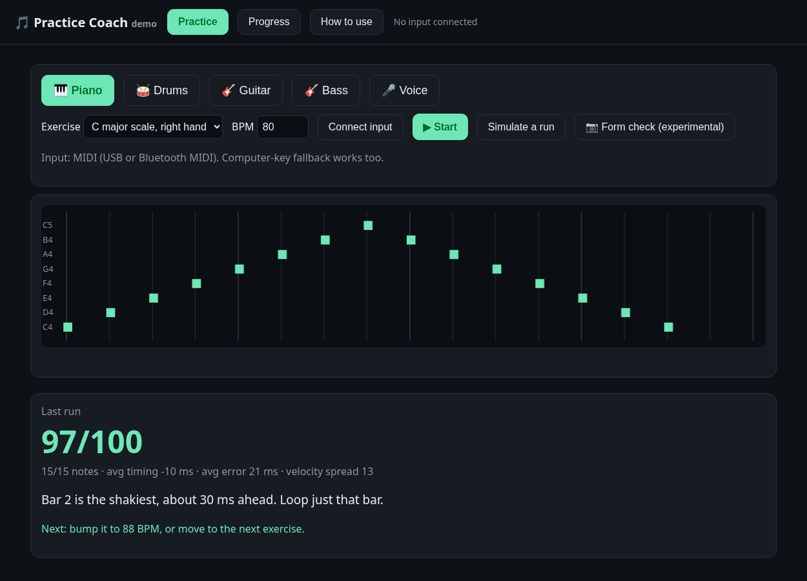

# Practice Coach

A single web page that scores a short practice exercise from a MIDI keyboard, your computer keys, or a microphone.

**Status: early prototype, not yet tested with a real instrument.**



## What it does today

`index.html` is the whole app. It runs in the browser. Scores stay in this browser (`localStorage`) and are not uploaded.

Pick an instrument and one of its built-in exercises, set a tempo (40–200 BPM), and press Start. A metronome counts in four beats, then the exercise runs. A lane shows the notes that were asked for. At the end the page gives a score out of 100, how many notes landed, the average timing in milliseconds (early or late), any missed or extra notes, and a short suggestion for what to try next. For MIDI input it also comments on how even the note velocities were. The Progress tab lists recent runs and draws a simple chart for the exercise currently selected.

What you can play:

- **Piano and drums** use Web MIDI. Press Connect input and allow MIDI. This path is meant for a USB MIDI keyboard, or a Bluetooth MIDI adapter. With nothing plugged in, the computer keyboard can stand in: piano uses A W S E D F T G Y H U J K for C4 to C5, and drums use A for kick, S for snare, and D for hi-hat.
- **Guitar, bass, and voice** use the microphone. The page estimates the pitch of one note at a time and scores the note name, so the octave is ignored.
- **Simulate a run** invents a slightly uneven performance, so the score and the written note can be seen with no instrument attached.
- **Form check (experimental)** turns the webcam on and downloads a MediaPipe hand-tracking model. It comments on flat fingers and, on piano, a dropping wrist. It is a rough sketch.

The built-in exercises are short: a C major scale, a I–IV–V–I chord pattern, and an arpeggio on piano; a basic rock beat and two simpler patterns on drums; pentatonic and open-string patterns on guitar; root patterns and an E major scale on bass; a short do–re–mi, a triad, and a held note for voice.

## How to run it

Open `index.html` in Chrome. For piano or drums, connect a MIDI keyboard by USB, then press **Connect input**.

If MIDI or the microphone will not connect when the file is opened directly, serve this folder and use localhost:

```bash
python3 -m http.server 8000
```

Then open <http://localhost:8000> in Chrome.

## GitHub Pages

After this is on `main`, the demo can be opened at <https://alexsokell.github.io/practice-coach>.

Turn Pages on in the repo: **Settings → Pages → Build and deployment → Source: GitHub Actions**. The workflow [`.github/workflows/pages.yml`](.github/workflows/pages.yml) publishes the files from `main`. That setting has to be switched on in GitHub; this repo change leaves it alone.

## Roadmap

- Test with a real keyboard.
- Practice-session feedback. Today each run is scored on its own.
- Drums and guitar later. The page already has untested exercise sketches for them.
- Camera-based hand-form feedback later. The webcam check in the page is experimental.

## Built in public

Follow along on X: https://x.com/alexsokell

## License

[MIT](LICENSE)
